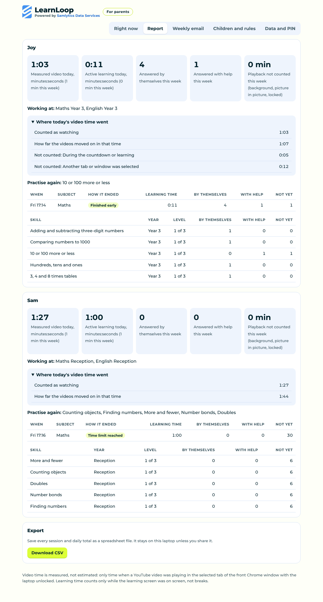

# LearnLoop

**Watch and learn. A free, open-source Chrome extension for families.**

Powered by Samlytics Data Services · Version 1.2 · MIT licence

[](https://github.com/SamsonOluwaseun/LearnLoop/raw/main/download/LearnLoop-v1.2.0.zip)

**[Download LearnLoop v1.2 (zip)](https://github.com/SamsonOluwaseun/LearnLoop/raw/main/download/LearnLoop-v1.2.0.zip)**, then follow the [setup guide](#install-on-a-windows-laptop-chrome). It takes about five minutes.

## Why I built this

I love my children, and they love screen time. I work from home, so I often see them giving all their attention to their cartoons on YouTube. One day I asked myself a simple question: what if I used the thing they love to help them do the thing I want them to do with their time?

That idea became LearnLoop. My children watch, then they learn, then they watch again. Because they know their video comes back once the learning is done, they settle into the questions, they try hard, and they enjoy their video more when it returns. The best part is that they like it. Their feedback has been really positive, and that is why I want other families to have it too.

LearnLoop is a Google Chrome extension that helps parents:

- choose how much YouTube time comes before a short learning break, for example 5 minutes of video and then up to 10 minutes of learning
- give each child Maths and English questions that follow the national curriculum in England, from Reception to Year 6, starting at their school year and getting harder as they succeed
- switch on Reasoning (11+ practice) for children in Years 4 to 6 who are preparing for a selective secondary school test
- choose topics to focus on or skip, and add your child's own school spelling list
- let children practise more whenever they like, including an optional "beat your own best" round that is only ever them against their own score
- keep learning bounded and kind: children can go back early once they show they understand, wrong answers get help rather than punishment, and the session always ends on time
- see real progress in a simple report and an optional weekly email
- keep everything private on their own laptop, with no accounts, adverts or tracking

## Open source, free, and new

LearnLoop is open source under the MIT licence and free to use. Anyone can read the code, use it at home, and help improve it.

This is version 1.2 of a new product. It works well in our home, but every family is different. If you try it, I would love to hear what worked, what didn't, and what would make it better. Please [open an issue](https://github.com/SamsonOluwaseun/LearnLoop/issues) with your ideas, questions or bug reports, or [message us on LinkedIn](https://www.linkedin.com/in/samlytics-data-service-487a7728a/). Suggestions from parents, teachers and developers are all very welcome.

Read [Known limitations](docs/KNOWN-LIMITATIONS.md) before you rely on it. It is a Chrome extension for Windows, and it is a family tool rather than a lock.



## What it does

- Measures real watching: only while a YouTube video is playing in the tab you are looking at, with Chrome in front and the laptop unlocked. Paused videos, background tabs and the lock screen are not counted.
- Shows a countdown such as "Well done, Joy! You've watched for 5 minutes. Let's try some Maths together." Then it pauses the video and saves its place.
- Runs a short learning session with **Help me**, **Say it again**, **Try another way** and **I need a break**.
  - Wrong answers get a clue, then a worked example, then the question moves on and comes back another day with a different example.
  - Answers given after a clue or worked example never count as "by themselves".
  - The session ends early once the child has answered enough different questions by themselves (4 by default) and the minimum time has passed. It always ends at the maximum time.
- Takes the child back to the same video at the same point. The video waits for the child to press play.
- Asks questions that follow the national curriculum in England, from Reception to Year 6, in Maths and English. The starting level comes from each child's date of birth, and questions get harder as the child answers well without help (see [the curriculum map](docs/CURRICULUM.md)).
- Offers **Reasoning (11+ practice)** for Years 4 to 6: verbal reasoning (codes, sequences, analogies, hidden words and more) and non-verbal reasoning (shape sequences, mirror images, turning shapes, shape grids and analogies). It is general practice, not tied to any area or exam board. Parents switch it on per child.
- Lets children **practise more** from the LearnLoop button in the toolbar, with no video needed. Extra practice never uses or earns video time. They can choose **Beat your own best**: 10 questions, where the score is how many they answer by themselves, compared only with their own best.
- Reads questions aloud for younger children using the voices already installed on Windows.
- Gives parents a report with measured video time, learning time, answers by themselves and with help, and skills to practise again. It updates by itself while open, and you can export it as a CSV file.
- Shows **Is it counting?** on the parent page and in the toolbar button, with the reason when it is not (video paused, another tab in front, laptop locked and so on).
- Prepares a **weekly report** for the parent's email address on the day you choose (see below).
- Protects settings with a parent PIN (stored as a salted hash) and a one-time recovery code.

## Install on a Windows laptop (Chrome)

You need Windows 10 or 11 and Google Chrome 116 or later.

1. **[Download LearnLoop v1.2 (zip)](https://github.com/SamsonOluwaseun/LearnLoop/raw/main/download/LearnLoop-v1.2.0.zip)**. The download starts straight away.
2. Right-click the zip, choose **Extract All**, and extract it to a folder that will stay put, for example `C:\Users\<you>\LearnLoop`. Chrome loads LearnLoop from this folder every time, so don't delete or move it.
3. Open Chrome and go to `chrome://extensions`.
4. Turn on **Developer mode** (top right).
5. Click **Load unpacked** and choose the folder you extracted (the one that contains `manifest.json`).
6. The LearnLoop parent page opens. Follow the steps below.
7. Optional: click the puzzle-piece icon in Chrome and pin LearnLoop so its status is one click away.

### First-time setup

1. **Choose a parent PIN** (4 to 8 digits) and press **Save PIN**.
2. **Write down the recovery code** that appears, tick **I have written it down**, and press **Continue**.
3. **Add your children.** The **Children and rules** page opens. For each child, enter their name and date of birth. LearnLoop works out their school year and sets the Maths and English levels from it. Choose the video and learning times (for example **5 min video, then up to 10 min learning**), then press **Save**. Use **Add another child** for each extra child.
4. **Open YouTube** in Chrome. LearnLoop asks **Who's watching?**. Tap the child's name and play a video. If YouTube was already open, reload that tab once (F5).
5. **Optional:** go to **Weekly email** to get a weekly summary.

Until steps 1 to 4 are done, the **Right now** page shows a **Finish setting up LearnLoop** checklist with a button for each step.

The first time YouTube is opened after Chrome starts, it asks **Who's watching?**. Switching to a different child after that needs the parent PIN.

### Switch on Reasoning (11+ practice)

For a child in Years 4 to 6, open **Children and rules**, tick **Reasoning (11+ practice, Years 4 to 6)** and press **Save**. Reasoning then takes its turn with Maths and English after each video. You can set its level by hand next to the other subjects.

### Topics and your child's spelling list

In **Children and rules**, open **Topics and spelling list** under a child.

- Set any topic to **Focus** to have it come up first in every session, or **Skip** to leave it out for now. You can also pick a focus topic from another year, for example times tables from Year 3 for a Year 4 child.
- Type or paste this week's school spellings into **Our spelling list**, separated by commas or spaces (up to 30 words). Once there are at least 3 words, they come up in every English session. Children first pick the right spelling from a few close misspellings, and later hear the word and type it, if typing is allowed.

Press **Save** when you're done. Levels still move up and down from your child's answers.

### Extra practice and beat your own best

Click the LearnLoop button in Chrome's toolbar and choose **Practise (no video needed)**. The child picks a subject. Tick **Beat your own best** for a 10-question round. You can set the longest practice session in **Children and rules** (15 minutes by default). Each child's best appears in the **Report**.

### Check the reading voice

LearnLoop uses Windows' own voices, so it works offline. To check or add a British English voice, open **Settings > Time & language > Speech** and look under **Manage voices**. Then open a learning session for the younger child and press 🔊.

### Share your experience

Once LearnLoop is installed and working, we would love to hear how it goes for your family. What did your children enjoy? What would make it better? Reach out to us on **[LinkedIn](https://www.linkedin.com/in/samlytics-data-service-487a7728a/)** and share your story. Let's help support our children's growth together.

## Levels and the curriculum

Each child starts at their school year, worked out from their date of birth (England, 1 September cut-off). A child born in March 2019, for example, is in Year 3. Reasoning starts at Year 4 at the earliest. Each skill then has three levels:

- a skill **moves up** when the child answers at least 5 of the last 6 questions on it without help, across two or more sessions
- it **moves back** if it is a struggle, so the child is never stuck on work that is too hard
- the **year moves up** for a subject when most of that year's skills are at the top level

Answers given after a clue or a worked example never count towards moving up. A birthday on its own never makes the questions harder. You can see every level change and the reason under **Report > Why levels changed**, and you can set the Maths, English or Reasoning level by hand in **Children and rules**.

The full list of skills, the curriculum statement each one follows, and the sources are in [docs/CURRICULUM.md](docs/CURRICULUM.md).

## Close the gaps

LearnLoop is a family tool, not a lock. The **Right now** page has a **Close the gaps** panel that lists the usual ways round it:

- **Incognito windows.** LearnLoop only runs there if you allow it. Go to `chrome://extensions`, click **Details** on LearnLoop and turn on **Allow in Incognito**. The panel shows a warning until you do.
- **Guest mode and other Chrome profiles.** They don't have LearnLoop. To turn off Guest mode, new profiles and Incognito on this laptop, download [close-the-gaps.reg](tools/windows/close-the-gaps.reg), double-click it and accept the Windows prompts, then restart Chrome. It uses Chrome's own documented settings and applies to every account on the laptop, yours included. [undo-close-the-gaps.reg](tools/windows/undo-close-the-gaps.reg) puts things back. You can check what is set at `chrome://policy`. These files have not yet been tried on our own laptop, so please tell us how they go.
- **Other browsers.** LearnLoop only sees the browser it's added to. It is built to work in Microsoft Edge too, but it hasn't been tested there yet. Otherwise, give your child their own Windows account with only Chrome and LearnLoop.

## Opening parent settings later

You can come back to the parent settings at any time to change rules, add a child, check the report or set up the weekly email. There are three ways in. Each one asks for your parent PIN.

**From the toolbar (easiest)**
1. In Chrome, click the LearnLoop icon (the blue Samlytics S) at the top right. If you can't see it, click the puzzle-piece icon and then LearnLoop. Click the pin next to it to keep it on the toolbar.
2. Click **Parent settings and report**.
3. Enter your PIN.

**By right-clicking the icon**
Right-click the LearnLoop icon and choose **Options**.

**From Chrome's extensions page**
1. Type `chrome://extensions` in the address bar and press Enter.
2. Find LearnLoop and click **Details**.
3. Scroll down and click **Extension options**.

Once you're in, the tabs at the top take you to **Right now**, **Report**, **Weekly email**, **Children and rules** and **Data and PIN**. After you change rules in **Children and rules**, press **Save**. The new rules apply straight away. The settings lock again after 15 minutes without use, and when Chrome is closed.

Forgot your PIN? Click **I forgot my PIN** on the PIN screen and enter the recovery code you wrote down when you set LearnLoop up.

## Weekly report by email

Open the parent page, go to **Weekly email**, enter your email address, choose the report day and press **Save**.

On that day LearnLoop prepares the past week's report and shows a Windows notification. Click it, press **Send to my email**, and your email app opens with the report filled in. Press Send. If the laptop is off on the report day, the report is prepared the next time it is used, and each week is prepared only once. You can also send the week so far at any time, copy the text, or download it as a web page.

LearnLoop does not send email by itself yet. That would mean storing your email password, which will only happen once a small Windows helper can keep it protected by Windows (planned for Milestone 2). If nothing happens when you press Send, your laptop has no default email app. Use **Copy text**, or set Gmail or Outlook as the default email app in Windows Settings.

## Why measured time can be shorter than the video

LearnLoop measures real time on screen, not the length of the video. A 6:30 video can show much less when:

- it was played faster (1.5x or 2x), or the child skipped ahead
- YouTube resumed it part-way through, because it had been watched before
- another window or app was in front, the video was in a background tab, or the laptop was locked
- it played before anyone chose who was watching
- a learning switch happened during it. The time since the last learning starts again from 0 after each session, while the day total keeps adding up.

Open **Report** and expand **Where today's video time went**. It shows the time counted, how far the videos moved on in that time, and each kind of time that was not counted. If the videos moved on much further than the time counted, that points to faster playback or skipping.

## The report shows 0 minutes

Check **Is it counting?** on the **Right now** page (or click the LearnLoop button in Chrome's toolbar) while a video plays. It tells you why time is not being counted:

- **Waiting for someone to choose who's watching**: pick a child on the YouTube page, or on **Right now**.
- **YouTube is not the selected tab** or **another window is in front**: only the video you are looking at is counted.
- **No signal from YouTube**: reload the YouTube tab once (F5). Version 0.1.0 did not count YouTube tabs that were already open when LearnLoop was installed. Version 0.2.0 fixes this.

## Updating

Download the new zip, extract it over the same folder (choose **Replace the files**), then click the circular **Reload** arrow on LearnLoop in `chrome://extensions`. Your settings and history are kept, and YouTube tabs that are already open are picked up automatically. Chrome may ask you to allow notifications for LearnLoop. Allow them if you want the weekly reminder.

## Uninstall

1. Go to `chrome://extensions` and click **Remove** on LearnLoop. This deletes all LearnLoop settings and history from Chrome.
2. Delete the folder you extracted.

If you want a copy of the history first, use **Report > Download CSV** before removing it.

Forgot your PIN? Use **I forgot my PIN** on the parent page with your recovery code. If the code is lost too, removing and adding LearnLoop again resets everything.

## Android app (early test version)

LearnLoop is coming to Android phones and tablets. The first test version shares the same questions and rules, and counts the time YouTube or YouTube Kids is on screen. It has not yet been tried on a real phone. See [mobile/README.md](mobile/README.md) for what it does, how to install the test version and the plan for Google Play and iPhone.

## For developers

```bash
# unit tests (Node 18 or later, no install needed)
node --test tests/*.test.js

# end-to-end test of the real extension in Chromium against a local stand-in video page
pip install playwright && python3 tests/e2e/run_e2e.py

# the phone app's screens at phone size, with a stand-in for Android
python3 tests/mobile/run_mobile_web.py

# build the release zip
bash scripts/build-release.sh
```

- [Architecture](docs/ARCHITECTURE.md)
- [Test report](docs/TEST-REPORT.md)
- [Checks to do on a real Windows laptop](docs/MANUAL-CHECKS.md)
- [Writing questions](docs/CONTENT-AUTHORING.md)
- [Privacy](docs/PRIVACY.md)
- [Contributing](CONTRIBUTING.md)
- [Chrome Web Store submission pack](store/chrome-web-store/LISTING.md)
- [Android sub-project](mobile/README.md)

## Licence and brand


The code and question packs are MIT licensed. See [LICENSE](LICENSE). Emoji pictures are drawn by the Windows emoji font and are not bundled.

The Samlytics Data Services name and logo (`extension/brand/` and `extension/icons/`) belong to Samlytics Data Services and are **not** covered by the MIT licence. If you fork LearnLoop, replace them with your own.

The Montserrat font (`extension/fonts/`) is by the Montserrat Project Authors under the SIL Open Font Licence 1.1. See `extension/fonts/OFL-Montserrat.txt` and [DEPENDENCIES.md](DEPENDENCIES.md).

LearnLoop is inspired by friendly practice apps for young children. It does not copy any of their code, branding or questions.

## Get in touch

LearnLoop is made by a parent, for parents, and powered by Samlytics Data Services. If it has helped your family, or you have ideas to make it better, please connect with us on [LinkedIn](https://www.linkedin.com/in/samlytics-data-service-487a7728a/) or [open an issue](https://github.com/SamsonOluwaseun/LearnLoop/issues). Let's help support our children's growth.
