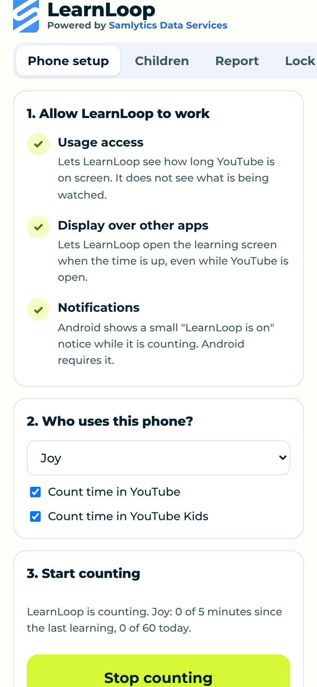
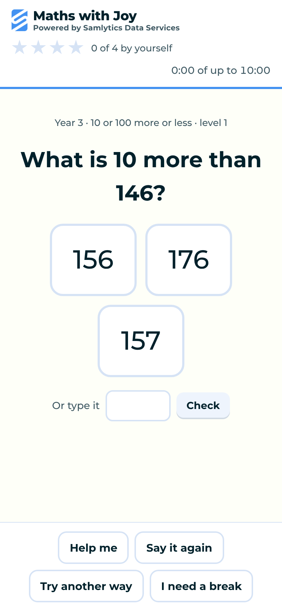

# LearnLoop for Android (sub-project, early test version)

This is the start of LearnLoop as a phone and tablet app. It is a separate sub-project in the same repository, so it shares the Chrome extension's question bank, tutoring engine, level rules and learning screen. A question fixed for Chrome is fixed for the phone too.

**Status: early test version, not yet tried on a real phone.** The app's screens have been tested in a browser at phone size with a stand-in for the Android side. The Android code is built by GitHub on every change, but it has not yet been installed on a phone. Please treat the first install as a test. It is not on Google Play.

 

## What it does

1. A parent sets a PIN, adds their children and chooses the rules, as in the Chrome extension.
2. The parent allows two Android permissions: **Usage access** and **Display over other apps**.
3. LearnLoop counts the minutes YouTube or YouTube Kids is on screen with the phone unlocked.
4. When the time is up, LearnLoop opens a gentle countdown, then a short Maths, English or reasoning session.
5. If the child goes back to YouTube during learning, LearnLoop comes back to the front.
6. After learning, **Back to my video** returns to YouTube. Children can also practise any time from the LearnLoop home screen.

## How it differs from the Chrome extension

| | Chrome extension | Android app |
|---|---|---|
| What is counted | A video actually playing in the front tab | YouTube or YouTube Kids on screen with the phone unlocked. Android does not tell apps whether a video is playing. |
| Pausing the video | Pauses and keeps the exact position | Opening LearnLoop puts YouTube in the background, which normally pauses it. LearnLoop cannot save the position. |
| During learning | YouTube pages open the learning screen | Opening YouTube brings LearnLoop back to the front |
| Reports | Report page, CSV and weekly email | A simple report on the phone |
| Topics to focus on or skip | Yes | Not yet (the spelling list is supported) |

## Install the test version

1. On the Android phone, open https://github.com/SamsonOluwaseun/LearnLoop/releases/tag/android-preview and download **LearnLoop-android-preview.apk**.
2. Open the file. Android asks whether to allow installs from your browser. Allow it for this install only.
3. Open LearnLoop, set your PIN and follow **Phone setup**.

Each test build is signed with a different temporary key, so to update you need to uninstall the old version first. This deletes its data. Proper signing comes with the Google Play version.

## Build it yourself

You need Node 18 or later, JDK 17 and the Android SDK (Android Studio installs it).

```bash
cd mobile/android
./gradlew assembleDebug        # the app is in app/build/outputs/apk/debug/app-debug.apk
```

The build first runs `node mobile/web/build.js`, which copies the shared files from `extension/` and adds the phone-only files in `mobile/web/`.

Test the screens in a browser at phone size, without a phone:

```bash
pip install playwright && python3 tests/mobile/run_mobile_web.py
```

## How it is built

- `mobile/web/`: the phone screens (`app.html`, `app.js`) and `shim.js`, which lets the extension's `learn.html` and `learn.js` run unchanged by answering the same messages the extension's background worker answers. Data is kept in the app's private storage through `store.js`.
- `mobile/android/`: a small Kotlin app.
  - `MainActivity` shows the screens in a WebView, served from inside the app so they work offline.
  - `Bridge` is the short list of things the screens may ask Android to do.
  - `MonitorService` checks every 5 seconds which app is in front, using Android's usage events, and keeps the counts. It runs as a foreground service with a "LearnLoop is on" notification, because Android requires one for anything that keeps running.
  - `BootReceiver` restarts counting after the phone restarts.
- No internet permission is requested. Nothing leaves the phone.

## Privacy

The app keeps the same data as the Chrome extension, on the phone only. It sees which app is in front, never what is being watched. See [the privacy policy](https://samsonoluwaseun.github.io/LearnLoop/privacy.html).

## Known gaps in this test version

- Not yet tested on a real phone, including how quickly LearnLoop comes to the front over YouTube on different Android versions. Android 14 and 15 tightened when apps may open themselves from the background. If the switch is blocked, LearnLoop shows a "Time to learn" notification instead.
- Some phone makers (for example Samsung, Xiaomi, Huawei) stop background services to save battery. Parents may need to set LearnLoop's battery use to **Unrestricted**.
- A child can still use other video apps, a browser, or another device. Like the extension, it is a family tool, not a lock.
- iPhone and iPad are planned for later. See [PLAN.md](PLAN.md).
